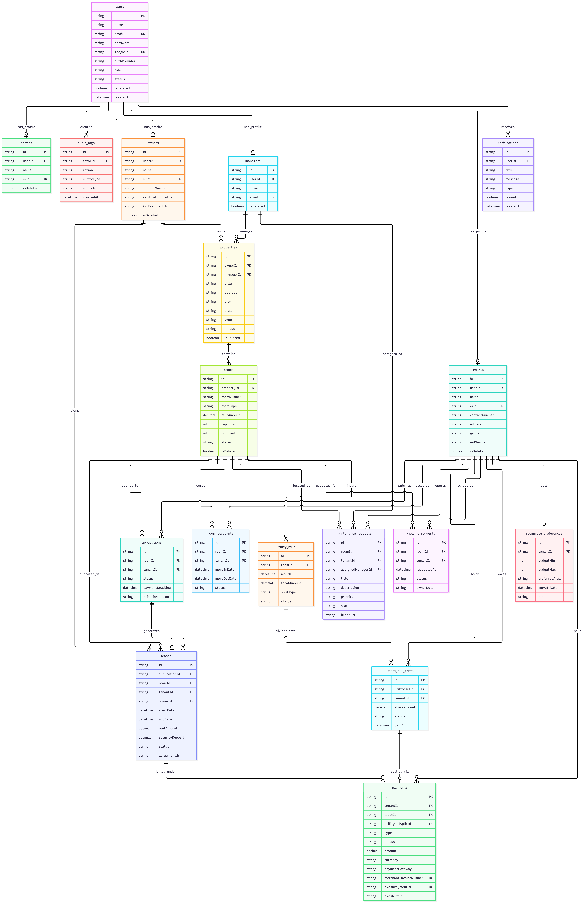

# NestHive — Housing & Roommate Management Platform

> 🌐 **Live Production URL:** [https://nesthive-backend.vercel.app](https://nesthive-backend.vercel.app)  
> 📑 **Interactive Swagger Docs:** [https://nesthive-backend.vercel.app/api-docs](https://nesthive-backend.vercel.app/api-docs)  
> 📄 **API Specification & Endpoints:** [`API.md`](./API.md)

NestHive is a comprehensive backend REST API for a modern housing rental and roommate matching ecosystem. Built for urban renters and property owners, NestHive streamlines the entire tenancy lifecycle from property discovery, viewing schedules, and roommate compatibility matching to digital applications, lease generation, bKash payment processing, utility bill splitting, and maintenance ticketing.

---

## 🛠️ Tech Stack

| Layer | Technology |
| --- | --- |
| **Runtime & Language** | Node.js (v20+) + TypeScript |
| **Framework** | Express 5 (`express`) |
| **Database** | PostgreSQL (Neon Serverless PostgreSQL) |
| **ORM** | Prisma 7 (`@prisma/client`, `@prisma/adapter-pg`) with multi-file schemas |
| **Cache & In-Memory Store** | Redis (`redis`) |
| **Authentication** | JWT (Access + Refresh tokens via httpOnly cookies & Bearer headers), Google OAuth 2.0 (`google-auth-library`) |
| **Password Hashing** | bcryptjs |
| **Payment Gateway** | bKash Tokenized Payment API (Create, Execute, Callback, Query) |
| **Security & Hardening** | Helmet (HTTP headers), `express-rate-limit` (200 requests / 15 minutes) |
| **Request Validation** | Zod v4 |
| **File Storage** | Cloudinary + Multer |
| **Mailing Service** | Nodemailer (SMTP with HTML email templates) |
| **API Documentation** | Swagger / OpenAPI 3.0 (`swagger-ui-express`) |
| **Dev Tooling & Linting** | tsx (watch mode), tsc (compiler), Biome (formatter & linter) |

---

## 📊 Entity Relationship Diagram (ERD)

> 

---

## 📂 Project Structure

Organized into a scalable modular architecture where each domain resource encapsulates its route, controller, service, validation, and interfaces:

```
src/
├── app.ts                          # Express application setup, security middlewares & route mounting
├── server.ts                       # App bootstrap, database connection & HTTP listener
├── interfaces/                     # Global shared interfaces (pagination, response, error types)
└── app/
    ├── config/                     # Environment configuration & variables
    ├── docs/                       # Swagger/OpenAPI specification & Swagger UI router
    ├── lib/                        # Singletons: Prisma client instance & Google Auth client
    ├── middleware/                 # Global error handler, not-found, auth guard, role check, validateRequest
    ├── templates/                  # EJS email notification templates
    ├── utils/                      # Utilities: catchAsync, sendResponse, jwt, redis, email, bKash, cloudinary
    └── module/
        ├── auth/                   # Registration, login, Google OAuth, refresh token, logout
        ├── user/                   # User profile, password management & role switches
        ├── tenant/                 # Tenant profiles, personal details & questionnaires
        ├── owner/                  # Owner profile management & KYC verification submission
        ├── manager/                # Manager assignment & property operations
        ├── admin/                  # Admin platform analytics, user moderation & audit logs
        ├── property/               # Property listings, multi-filter search & management
        ├── room/                   # Rooms inventory, pricing, availability & occupants
        ├── roomOccupant/           # Active tenant occupancy assignments
        ├── roommatePreference/     # Roommate matching survey & compatibility engine
        ├── viewingRequest/         # Physical viewing bookings, scheduling & status updates
        ├── application/            # Tenancy applications, document verification & approvals
        ├── lease/                  # Tenancy agreements, digital terms & active leases
        ├── payment/                # bKash tokenized payment checkout, callback & query
        ├── utilityBill/            # Utility bills creation & per-occupant split calculations
        ├── maintenance/            # Maintenance issue tickets, priority levels & status updates
        └── notification/           # System & user notification alerts
prisma/
├── schema/                         # Multi-file Prisma schemas (user, property, room, payment, etc.)
└── migrations/                     # PostgreSQL database migration history
```

---

## 👥 Roles & Permissions

NestHive implements Role-Based Access Control (RBAC) enforced through authentication and authorization middlewares:

| Role | Description |
| --- | --- |
| **TENANT** | Searches & filters listings, schedules viewing appointments, applies for rooms, signs leases, pays deposits/rent/utility splits via bKash, creates maintenance requests, and completes roommate compatibility profiles. |
| **OWNER** | Manages owned properties and room inventory, submits KYC verification documents, reviews and approves/rejects viewings and tenancy applications, and creates monthly utility bills with automated occupant splits. |
| **ADMIN** | Platform supervisor; approves or rejects owner KYC credentials, activates or blocks users, views system-wide audit logs and platform revenue statistics. |
| **MANAGER** | Assigned by administrators to oversee property maintenance, coordinate inspections, and supervise unit operations. |

---

## ⚙️ Setup & Installation

### 1. Clone & install dependencies

```bash
git clone https://github.com/mdyhakash/nesthive-backend.git
cd nesthive-backend
npm install
```

### 2. Environment Variables

Create a `.env` file in the project root with the following configuration:

```env
NODE_ENV=development
PORT=5000

# Database (PostgreSQL)
DATABASE_URL="postgresql://<user>:<password>@<host>:<port>/<dbname>?sslmode=require"

# JWT Secrets & Expiration
JWT_ACCESS_SECRET=your_super_secret_access_key
JWT_REFRESH_SECRET=your_super_secret_refresh_key
JWT_ACCESS_EXPIRES_IN=1d
JWT_REFRESH_EXPIRES_IN=7d
BCRYPT_SALT_ROUNDS=10

# URLs
BACKEND_URL=http://localhost:5000
FRONTEND_URL=http://localhost:3000

# Google OAuth 2.0
GOOGLE_CLIENT_ID=your-google-oauth-client-id.apps.googleusercontent.com

# Seed Demo Credentials
ADMIN_NAME=Admin
ADMIN_EMAIL=admin@gmail.com
ADMIN_PASSWORD=Admin123@

OWNER_NAME=Owner
OWNER_EMAIL=owner@gmail.com
OWNER_PASSWORD=Owner123@

MANAGER_NAME=Manager
MANAGER_EMAIL=manager@gmail.com
MANAGER_PASSWORD=Manager123@

# Redis Cache
REDIS_USER=default
REDIS_PASSWORD=your_redis_password
REDIS_HOST=your_redis_host
REDIS_PORT=12680

# Nodemailer / SMTP
SMTP_USER=your_email@gmail.com
EMAIL_SENDER=your_email@gmail.com
SMTP_PASSWORD=your_google_app_password

# Cloudinary Storage
CLOUDINARY_CLOUD_NAME=your_cloud_name
CLOUDINARY_API_KEY=your_cloudinary_api_key
CLOUDINARY_API_SECRET=your_cloudinary_api_secret

# bKash Tokenized Payment Credentials
BKASH_BASE_URL=https://tokenized.sandbox.bka.sh/v1.2.0-beta
BKASH_USERNAME=sandboxTokenizedUser02
BKASH_PASSWORD=sandboxTokenizedUser02@12345
BKASH_APP_KEY=your_bkash_app_key
BKASH_APP_SECRET=your_bkash_app_secret
BKASH_CALLBACK_URL=http://localhost:5000/api/v1
```

### 3. Run Prisma Migrations & Generate Client

```bash
npx prisma generate
npx prisma migrate dev
```

### 4. Run the Dev Server

```bash
npm run dev
```

The server starts locally at `http://localhost:5000`.

### 5. Build for Production

```bash
npm run build
npm start
```

---

## 🔑 Demo & Admin Credentials

Pre-configured demo accounts for grading, evaluation, and API testing:

| Role | Email | Password |
| --- | --- | --- |
| **ADMIN** | `admin@gmail.com` | `Admin123@` |
| **OWNER** | `owner@gmail.com` | `Owner123@` |
| **MANAGER** | `manager@gmail.com` | `Manager123@` |

---

## 📡 Authentication & Security

- **Dual Authentication**:
  - **Email & Password**: Registration and login with bcrypt salted password hashing.
  - **Google OAuth 2.0**: Direct verification of Google ID tokens via `google-auth-library`.
- **Hybrid Token Storage**:
  - Upon successful login or refresh, `accessToken` and `refreshToken` are stored in secure, `httpOnly`, `sameSite` cookies **and** returned in the JSON response payload.
- **Header or Cookie Authorization**:
  - All protected endpoints accept authentication through either the `accessToken` httpOnly cookie or an `Authorization: Bearer <accessToken>` header.
- **Account Status Guard**:
  - Accounts with status `BLOCKED` are automatically rejected on login and on any subsequent authenticated request.
- **Logout Endpoint**:
  - `POST /api/v1/auth/logout` explicitly clears both access and refresh cookies.
- **Traffic Protection**:
  - Integrated `helmet` security headers.
  - Rate limiting with `express-rate-limit` (200 requests per 15-minute window per IP).

---

## 📦 Standard Response Shape

### Success Response:

```json
{
  "success": true,
  "statusCode": 200,
  "message": "Properties retrieved successfully.",
  "meta": {
    "page": 1,
    "limit": 10,
    "total": 24,
    "totalPage": 3
  },
  "data": [
    {
      "id": "cm08...abc",
      "title": "Modern Studio in Banani",
      "city": "Dhaka",
      "rent": 18000,
      "isAvailable": true
    }
  ]
}
```

### Error Response:

```json
{
  "success": false,
  "statusCode": 400,
  "message": "Validation Error",
  "errors": [
    {
      "path": "email",
      "message": "Invalid email address format"
    }
  ]
}
```

---

## 🔗 API Reference

All endpoints are versioned under the `/api/v1` base URL.

👉 **For the complete 60+ endpoint specifications, query parameters, request bodies, and role access matrices, please refer to the dedicated API documentation:**

### 📄 [Read the Full API Specification (API.md)](./API.md)

**Modules documented in `API.md`:**
* **Auth**: Registration, Login, Google OAuth, Refresh Token, Change Password, Logout
* **User & Profile**: Current user profile, profile updates, account status
* **Tenant & Roommate Matching**: Tenant details, roommate survey, matching algorithm
* **Owner & KYC**: Owner profile, KYC document upload and verification
* **Properties & Rooms**: Full search, multi-criteria filters, image uploads, room availability
* **Viewing Requests**: Physical visit scheduling, owner confirmation, cancellation
* **Applications & Leases**: Tenancy applications, screening, approvals, lease contracts
* **Payments (bKash)**: Create payment session, execute payment, callback webhook, payment history
* **Utility Bills**: Monthly bill recording, auto-split per active room occupant, individual payments
* **Maintenance Tickets**: Tenant issue reporting, priority levels, manager assignment, resolution
* **Admin & Audit**: User moderation, KYC approvals, platform metrics, tamper-evident audit logs

---

## 📖 Interactive Swagger API Documentation

NestHive features interactive OpenAPI 3.0 / Swagger documentation. You can test all endpoints directly from your browser:

* 🌐 **Interactive Swagger UI (Live):** [https://nesthive-backend.vercel.app/api-docs](https://nesthive-backend.vercel.app/api-docs)
* 📄 **OpenAPI Specification (JSON):** [https://nesthive-backend.vercel.app/api-docs/swagger.json](https://nesthive-backend.vercel.app/api-docs/swagger.json)

> **Testing Authenticated Endpoints in Swagger UI:**  
> 1. Click the green **Authorize 🔓** button at the top of Swagger UI.  
> 2. Paste your `accessToken` into the `BearerAuth` input field (`Bearer <token>` or just `<token>`).  
> 3. Execute any endpoint directly from the browser!

---